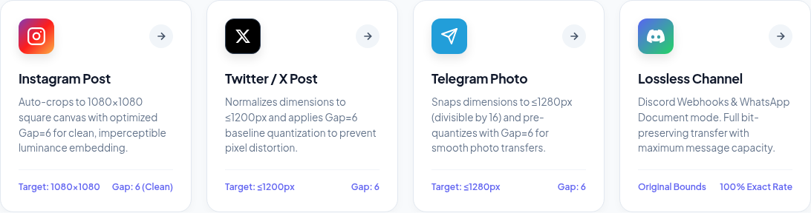
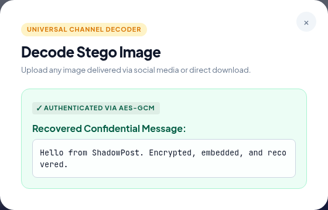
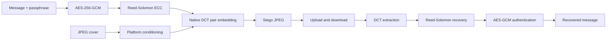

<p align="center">
  
</p>

<h1 align="center">ShadowPost</h1>

<p align="center">
  Open-source native-JPEG steganography with encrypted messages and adaptive delivery profiles.
</p>

<p align="center">
  <a href="LICENSE"></a>
  
  
</p>

<p align="center">
  <a href="#the-platform">Screenshots</a> ·
  <a href="#before-and-after-platform-testing">Results</a> ·
  <a href="#what-we-customized">Custom profiles</a> ·
  <a href="#setup">Get started</a> ·
  <a href="#contributing">Contribute</a>
</p>

ShadowPost is a Python steganography research project that hides AES-256-GCM encrypted messages in JPEG images and investigates their survival through lossy social-media delivery. It encodes bits through the relative magnitudes of pairs of quantized DCT coefficients, rather than coefficient parity: recompression can change parity and destroy parity-based payloads. Reed-Solomon error correction helps recover damaged messages, while direct coefficient access preserves the native JPEG embedding path. ShadowPost remains an in-progress research project, not production-ready software.

## The platform

Choose a delivery profile, provide a JPEG cover and message, then download the encrypted stego JPEG. The decoder accepts the received JPEG and the same passphrase.



<table>
  <tr>
    <td width="50%"><strong>Encode with a platform profile</strong></td>
    <td width="50%"><strong>Recover and authenticate a message</strong></td>
  </tr>
  <tr>
    <td></td>
    <td></td>
  </tr>
</table>

These screenshots show the current application and a local encode/decode demonstration. Platform delivery outcomes are listed below.

## Architecture

**AES-256-GCM encryption → Reed-Solomon ECC → DCT embedding through jpeglib.** Extraction reverses those steps and authenticates the recovered ciphertext before returning the message.



- `crypto.py`: scrypt derives a 32-byte AES key from the passphrase. Each encryption uses a fresh 12-byte nonce and a 16-byte authentication tag.
- `ecc.py`: the framed message is split into 32-byte data chunks and encoded as RS(48,32), with 16 parity bytes per codeword.
- `dct_codec.py`: `jpeglib.read_dct()` and `write_dct()` provide direct libjpeg coefficient access. Bits use pairwise magnitude ordering in luminance blocks; equality decodes as `1`.
- `pipeline.py`: combines the two-byte length prefix, encryption, ECC, capacity checks, and embedding/extraction.
- `profiles.py`: experimental cover conditioning for supported delivery profiles. The application uses pair positions `(1,3)/(2,2)` and `(1,4)/(4,1)`, with a coefficient gap of `6`.
- `api.py`: FastAPI upload/download interface. The root `app.py` is a small ASGI entry point.

Pillow conditions covers and simulates recompression in experiments; it does not perform DCT embedding or extraction. Lab experiments retain their original default gap of `24`. The phase-3 experiment uses a fixed four-byte plaintext container; the application supports multiple codewords.

## Before and after platform testing

The original delivery study recorded **270 trials: 45 per delivery mode**. After platform-specific customization, the author's manual upload/download retests on **13 November 2026** reported successful message recovery on Discord, WhatsApp Document, Telegram, Twitter/X, and Instagram. **WhatsApp Image mode still fails.**

| Platform | Delivery mode | Before: original benchmark | After: latest manual retests |
|---|---|---:|---|
| Discord | Attachment | 45/45 — 100% | Successful recovery |
| WhatsApp | Document | 45/45 — 100% | Successful recovery |
| Telegram | Image | 36/45 — 80% | Successful recovery |
| Twitter / X | Image | 0/45 — 0% | Successful recovery |
| Instagram | Image | 0/45 — 0% | Successful recovery |
| WhatsApp | Image | 0/45 — 0% | **Failed — open limitation** |

Twitter/X and Instagram changed from no exact recoveries in the recorded benchmark to successful recovery in the latest manual tests. Telegram also recovered messages in the latest retests. The original pass rates and trial records remain available in [results/README.md](results/README.md) and the [canonical delivery CSV](results/phase5/platform_trials.csv).

## What we customized

The initial benchmark exposed the limits of applying one native-DCT embedding workflow across different image-delivery paths. The application now selects a conditioning profile for the intended platform **before** embedding the encrypted payload.

| Profile | Configured image bounds | Aspect handling | JPEG conditioning quality | DCT gap |
|---|---|---|---:|---:|
| Discord attachment | Original dimensions | Preserve cover | No pre-save | 6 |
| WhatsApp Document | Original dimensions | Preserve cover | No pre-save | 6 |
| Telegram Image | Up to 1280 × 1280 | Preserve aspect ratio | 85 | 6 |
| Twitter / X Image | Up to 1200 × 1200 | Preserve aspect ratio | 82 | 6 |
| Instagram Image | Up to 1080 × 1080 | Center crop to square | 80 | 6 |
| WhatsApp Image | No working dedicated profile | Open problem | — | — |

The profile code configures dimensions on a multiple-of-16 grid, RGB JPEG conditioning with 4:4:4 chroma sampling, and platform-specific JPEG quality. Instagram additionally uses a square center crop. Discord attachments and WhatsApp documents skip this conditioning step and preserve the input cover's dimensions.

All current profiles retain the same AES-256-GCM encryption, RS(48,32) error correction, and two relative-magnitude DCT pairs per luminance block. The application uses gap **6**, while the original lab scripts retain gap **24**. Profiles change cover conditioning; encryption, error correction, and coefficient-pair selection remain shared.

Exact settings live in [`src/shadowpost/profiles.py`](src/shadowpost/profiles.py). They are experimental presets, not platform specifications or guarantees for every upload.

## Setup

Use **Python 3.12**; package metadata requires Python 3.12 or newer. The setup below uses Python 3.12.

```bash
git clone https://github.com/Arman-Khan-24/ShadowPost.git
cd ShadowPost
python3.12 -m venv .venv
source .venv/bin/activate
python -m pip install -r requirements.txt
python -m pip install --no-deps -e .
```

`jpeglib` supplies native libjpeg access. A compatible binary wheel avoids a local native build. For a Linux source build, install a C/C++ build toolchain and JPEG development headers, for example:

```bash
sudo apt-get install build-essential libjpeg-dev
```

Tests, platform experiment clients, plotting, and paper scripts have additional dependencies:

```bash
python -m pip install -r requirements-dev.txt
python -m pytest tests/test_app.py
```

Run the browser interface and API:

```bash
uvicorn app:app --host 127.0.0.1 --port 8000 --reload
```

Open `http://127.0.0.1:8000`; interactive API documentation is at `/docs`. Docker uses the same ASGI entry point. The Vercel configuration serves the static interface under `web/`.

## Usage

Embed and extract in one Python session. Supply a JPEG cover as `cover.jpg`:

```python
from getpass import getpass
from pathlib import Path
from shadowpost import encode_file, decode_file

passphrase = getpass("Passphrase: ")
output = Path("results/local/stego.jpg")
output.parent.mkdir(parents=True, exist_ok=True)

info = encode_file(
    Path("cover.jpg"), output,
    "Hidden hello".encode("utf-8"), passphrase,
    platform="telegram",
)
print(info)
print(decode_file(output, passphrase))
```

For a delivery test, upload the produced JPEG, download the delivered file, then pass that downloaded file to `decode_file`. Available profile IDs are `default`, `discord`, `whatsapp_doc`, `telegram`, `twitter`, and `instagram`. WhatsApp Image has no working delivery profile.

The HTTP interface accepts `POST /encode` with `cover`, `message`, `passphrase`, and optional `platform`; it returns the stego JPEG. `POST /decode` accepts `stego` and `passphrase` and returns the recovered UTF-8 message. `GET /platforms` lists profile settings.

Run research scripts from the repository root as modules:

```bash
python -m experiments.dct_coefficient_experiment --covers-dir /path/to/covers
python -m experiments.rs_roundtrip --covers-dir /path/to/covers
python -m experiments.aes_gcm_roundtrip --covers-dir /path/to/covers
python -m scripts.benchmark_charts
```

See [experiment instructions](experiments/README.md) for manual delivery checks and benchmark runs. New experiment outputs default to ignored `results/local/`; historical evidence remains under the other `results/` directories.

## Contributing

Contributions are welcome, especially work on WhatsApp Image delivery, coefficient-grid synchronization, reproducible platform trials, and visual-quality or detectability analysis.

1. Open an [issue](https://github.com/Arman-Khan-24/ShadowPost/issues) describing the problem, platform/client, delivery mode, and reproducible steps.
2. Fork the repository and make one focused change. Keep core logic in `src/shadowpost/`; place experiment drivers under `experiments/`.
3. Install `requirements-dev.txt`, run `python -m pytest`, and include the relevant validation in your pull request.
4. For recovery claims, include the tested sample count, exact pass/fail counts, profile settings, and the delivered files or reproducible logs. Never commit credentials or private test messages.

## Known limitations and open problems

- **WhatsApp Image mode currently fails. Reliable recovery through that delivery mode is an open problem.** Use Document mode for the tested WhatsApp workflow.
- Platform resizing, cropping, and recompression can alter the coefficient grid or ordering. Successful manual tests do not guarantee every client, upload setting, cover, or payload will survive.
- RS(48,32) can correct at most eight erroneous byte symbols per codeword. Damage beyond that limit can prevent recovery.
- Capacity depends on luminance block count and framing overhead. The API stores UTF-8 messages and uses a two-byte plaintext-length field.
- The existing KDF uses a fixed public protocol salt. Strong passphrases remain important; per-message salt framing is future work.
- Encryption authenticates message contents; steganography does not guarantee resistance to detection. Visual artifacts and detectability require further study.
- Original cover images are external to this repository. Some archived experiment manifests contain Windows paths; supply the local cover directory when reproducing those runs.

## License and author

[MIT License](LICENSE). Copyright © 2026 Arman Rizwan Khan and ShadowPost Project Contributors.

Author: [Arman Khan](https://github.com/Arman-Khan-24).

[Current implementation state](CURRENT_STATE.md) · [Archived paper](research/papers/ShadowPost_IEEE_Paper.pdf)
