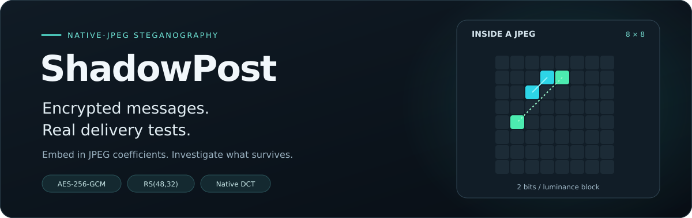
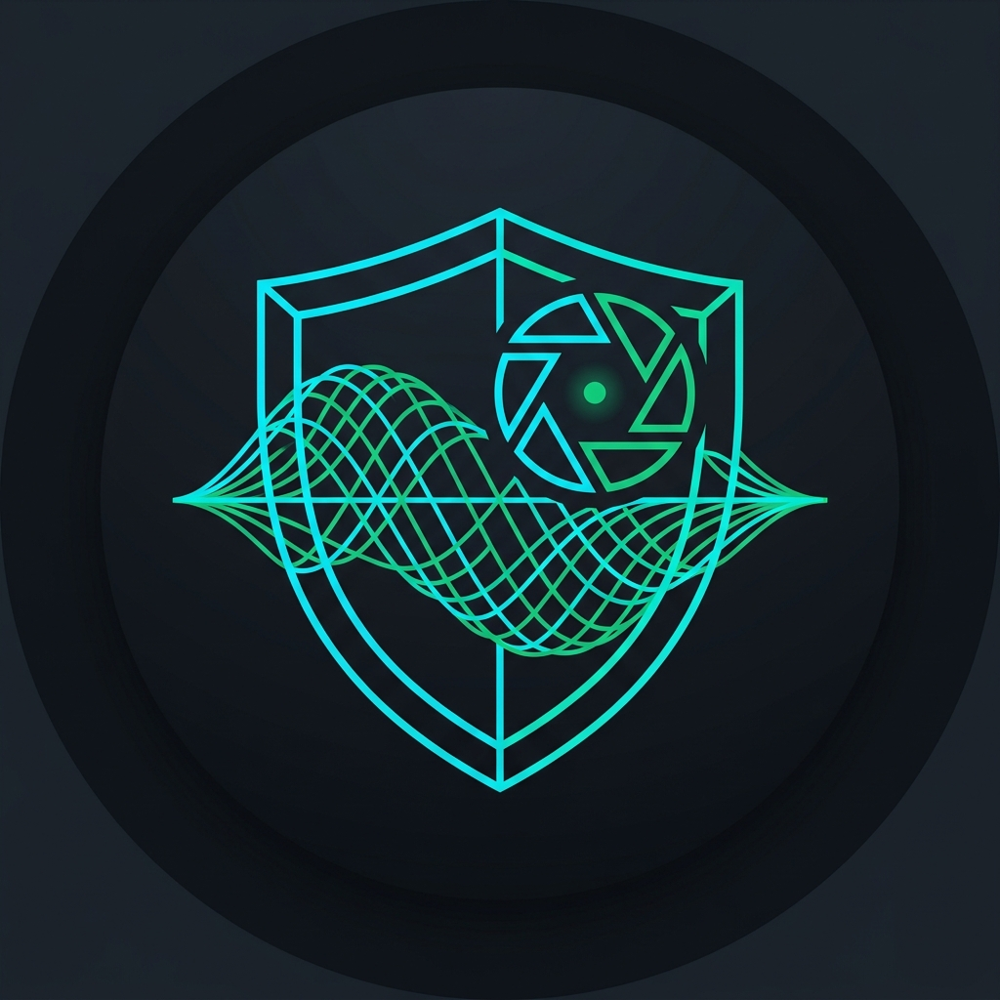
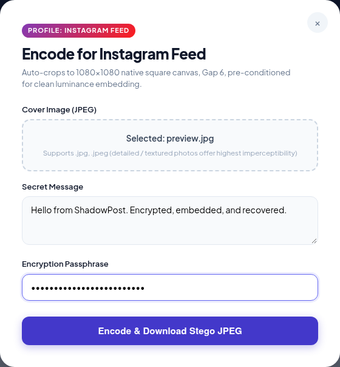
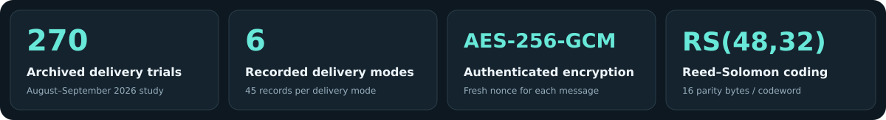
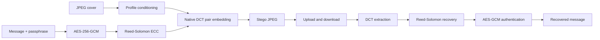

<div align="center">
<a name="readme-top"></a>





# ShadowPost

**Hide an encrypted message. Study what survives delivery.**

Native-JPEG steganography with AES-256-GCM, Reed–Solomon recovery,<br/>
and experimental profiles for social-media image delivery.

[**Get started**](#setup) · [**Features**](#features) · [**Results**](#before-and-after-platform-testing) · [**Research paper**][paper-link] · [**Report an issue**][issues-link]

[![Python 3.12 or later][python-badge]](pyproject.toml)
[![MIT license][license-badge]](LICENSE)
[![Research project][research-badge]](CURRENT_STATE.md)
[![Native JPEG DCT][dct-badge]](src/shadowpost/dct_codec.py)
[![GitHub stars][stars-badge]][stars-link]

</div>

<br/>

<div align="center">


<sub>Actual application screenshots. Profiles condition the cover before the encrypted payload is embedded.</sub>

</div>

<details>
<summary><strong>Explore the README</strong></summary>

- [Why ShadowPost](#why-shadowpost)
- [Features](#features)
- [The platform](#the-platform)
- [Before and after platform testing](#before-and-after-platform-testing)
- [What we customized](#what-we-customized)
- [Setup](#setup)
- [Usage](#usage)
- [Architecture](#architecture)
- [Research and documentation](#research-and-documentation)
- [Development](#development)
- [Known limitations and open problems](#known-limitations-and-open-problems)
- [FAQ](#faq)
- [Contributing](#contributing)
- [License and author](#license-and-author)

</details>

## Why ShadowPost

A message can decode perfectly from a JPEG on your machine and disappear after the image is uploaded, resized, and recompressed.

ShadowPost explores that gap. It embeds encrypted messages directly into JPEG DCT coefficients, then investigates recovery from the files delivered by real platforms. Cover conditioning, error correction, and authenticated decoding make each stage explicit.

**Local recovery is the starting point. Delivery survival is the research question.**

This is an in-progress research project. Platform presets are experimental, and the recorded study remains available alongside newer author-reported manual checks.

## Features

<table>
  <tr>
    <td width="50%" valign="top">
      <strong>Embed inside native JPEG coefficients</strong><br/>
      Encode bits through relative magnitudes of DCT coefficient pairs using direct libjpeg access through jpeglib.
    </td>
    <td width="50%" valign="top">
      <strong>Encrypt and authenticate the message</strong><br/>
      Derive an AES-256 key with scrypt, encrypt with a fresh nonce, and authenticate the recovered ciphertext with AES-GCM.
    </td>
  </tr>
  <tr>
    <td width="50%" valign="top">
      <strong>Condition for the delivery path</strong><br/>
      Select a profile for Discord attachments, WhatsApp documents, Telegram, Twitter/X, or Instagram before embedding.
    </td>
    <td width="50%" valign="top">
      <strong>Inspect recovery, not appearances alone</strong><br/>
      Use Reed–Solomon error correction, a browser encoder/decoder, and research scripts backed by preserved trial records.
    </td>
  </tr>
</table>

## The platform

### 01 · Choose the destination, then encode

Select a delivery profile, upload a JPEG cover, enter a UTF-8 message and passphrase, and download the stego JPEG. The selected profile conditions the cover before embedding; the app checks whether the message fits the resulting image.

<div align="center">



</div>

### 02 · Recover from the received file

Download the delivered JPEG and decode it with the same passphrase. Extraction and Reed–Solomon recovery run before AES-GCM authentication; the app reports authentication, capacity, and decode errors.

<div align="center">


<sub>These screenshots show the existing application and a local encode/decode demonstration. They do not establish social-platform recovery rates.</sub>

</div>

## Before and after platform testing

[](results/README.md)

The preserved **August–September 2026 study contains 270 records: 45 per delivery mode**. Counts below come from the canonical CSV's `success` field. The author's **13 November 2026 manual retests** reported recovery on five modes; WhatsApp Image still failed.

| Platform | Delivery mode | Recorded study: exact recovery | Newer manual retests: author-reported |
| :--- | :--- | ---: | :--- |
| Discord | Attachment | **45/45 · 100%** | Successful recovery |
| WhatsApp | Document | **45/45 · 100%** | Successful recovery |
| Telegram | Image | **36/45 · 80%** | Successful recovery |
| Twitter / X | Image | **0/45 · 0%** | Successful recovery |
| Instagram | Image | **0/45 · 0%** | Successful recovery |
| WhatsApp | Image | **0/45 · 0%** | **Failed · open limitation** |

> [!NOTE]
> Newer manual retests have no saved per-trial counts or logs, so they establish no measured improvement percentage. The original matrix differs by delivery mode and includes capacity-rejected trials; some rows came from manual reports. Read the methodology before comparing rates or describing all 270 records as automated telemetry.

Twitter/X and Instagram moved from no exact recoveries in the recorded study to author-reported successful recovery in later manual checks. Reproducible trials with the current profiles remain useful next work.

[Read the recorded study](results/README.md) · [Inspect all 270 records](results/phase5/platform_trials.csv) · [Browse archived charts](results/phase7/) · [Read the paper][paper-link]

<div align="right">

[Back to top](#readme-top)

</div>

## What we customized

Different delivery paths resize and recompress images differently. ShadowPost conditions the cover for the intended destination **before** inserting the encrypted payload.

| Profile | Configured image bounds | Aspect handling | JPEG conditioning quality | DCT gap |
| :--- | :--- | :--- | ---: | ---: |
| Discord attachment | Original dimensions | Preserve cover | No pre-save | 6 |
| WhatsApp Document | Original dimensions | Preserve cover | No pre-save | 6 |
| Telegram Image | Up to 1280 × 1280 | Preserve aspect ratio before grid alignment | 85 | 6 |
| Twitter / X Image | Up to 1200 × 1200 | Preserve aspect ratio before grid alignment | 82 | 6 |
| Instagram Image | Up to 1080 × 1080 | Center crop to square | 80 | 6 |
| WhatsApp Image | No working dedicated profile | Open problem | — | — |

The profiles configure RGB JPEG output, 4:4:4 chroma sampling, and a target grid aligned to multiples of 16. Discord attachments and WhatsApp documents skip conditioning and retain the input cover's dimensions. The bounds above are profile targets; the current resize edge case is listed below.

All application profiles share **AES-256-GCM, RS(48,32), two DCT pairs per luminance block, and gap 6**. The original lab scripts retain **gap 24**. These are experimental presets, rather than specifications supplied by the platforms.

The exact settings are in [`src/shadowpost/profiles.py`](src/shadowpost/profiles.py).

## Setup

Use **Python 3.12** for the setup below. Package metadata requires Python 3.12 or newer; native `jpeglib` wheel availability depends on your Python version and operating system.

<details open>
<summary><strong>Linux / macOS</strong></summary>

```bash
git clone https://github.com/Arman-Khan-24/ShadowPost.git
cd ShadowPost
python3.12 -m venv .venv
source .venv/bin/activate
python -m pip install -r requirements.txt
python -m pip install --no-deps -e .
uvicorn app:app --host 127.0.0.1 --port 8000
```

</details>

<details>
<summary><strong>Windows · PowerShell</strong></summary>

```powershell
git clone https://github.com/Arman-Khan-24/ShadowPost.git
cd ShadowPost
py -3.12 -m venv .venv
.\.venv\Scripts\python.exe -m pip install -r requirements.txt
.\.venv\Scripts\python.exe -m pip install --no-deps -e .
.\.venv\Scripts\python.exe -m uvicorn app:app --host 127.0.0.1 --port 8000
```

If the Python launcher is unavailable, use the path to your Python 3.12 interpreter in place of `py -3.12`.

</details>

<details>
<summary><strong>Docker</strong></summary>

```bash
git clone https://github.com/Arman-Khan-24/ShadowPost.git
cd ShadowPost
docker build -t shadowpost .
docker run --rm -p 127.0.0.1:8000:8000 shadowpost
```

The existing [Dockerfile](Dockerfile) uses Python 3.12 and the same ASGI entry point.

</details>

Open **[http://127.0.0.1:8000](http://127.0.0.1:8000)** for the browser interface. Interactive API documentation is at **[/docs](http://127.0.0.1:8000/docs)**.

A compatible `jpeglib` binary wheel avoids a local native build. A Linux source build needs a C/C++ toolchain and JPEG development headers, for example `sudo apt-get install build-essential libjpeg-dev`. The Vercel configuration serves the static interface under `web/`; the FastAPI backend runs separately.

## Usage

### Python library

Supply a JPEG as `cover.jpg`. This example encodes and recovers a UTF-8 message locally:

```python
from getpass import getpass
from pathlib import Path
from shadowpost import encode_file, decode_file

passphrase = getpass("Passphrase: ")
output = Path("results/local/stego.jpg")
output.parent.mkdir(parents=True, exist_ok=True)

info = encode_file(
    Path("cover.jpg"), output,
    "Hello from ShadowPost".encode("utf-8"), passphrase,
    platform="telegram",
)
print(info)
print(decode_file(output, passphrase))
```

To test delivery, upload the produced JPEG, download the platform's delivered file, and pass **that downloaded file** to `decode_file`.

Available profile IDs: `default`, `discord`, `whatsapp_doc`, `telegram`, `twitter`, and `instagram`. WhatsApp Image has no working delivery profile.

### HTTP API

| Endpoint | Input | Output |
| :--- | :--- | :--- |
| `POST /encode` | Multipart `cover`, `message`, `passphrase`, optional `platform` | Stego JPEG |
| `POST /decode` | Multipart `stego`, `passphrase` | JSON with the recovered UTF-8 `message` |
| `GET /platforms` | None | Configured profile settings |

The API accepts JPEG uploads up to **25 MiB**. Message capacity depends on the cover after conditioning, rather than a fixed character limit.

## Architecture



| Component | Responsibility |
| :--- | :--- |
| [`crypto.py`](src/shadowpost/crypto.py) | scrypt key derivation, fresh nonces, encryption, and authentication |
| [`ecc.py`](src/shadowpost/ecc.py) | RS(48,32) codewords and byte/bit conversion |
| [`dct_codec.py`](src/shadowpost/dct_codec.py) | Direct JPEG coefficient access and relative-magnitude pair embedding/extraction |
| [`pipeline.py`](src/shadowpost/pipeline.py) | Message framing, capacity checks, and the complete encode/decode flow |
| [`profiles.py`](src/shadowpost/profiles.py) | Experimental cover conditioning for each delivery path |
| [`api.py`](src/shadowpost/api.py) | FastAPI upload/download boundary and browser interface routes |

<details>
<summary><strong>Protocol details</strong></summary>

- scrypt derives a **32-byte key** using a fixed public versioned protocol salt. AES-GCM uses a fresh **12-byte nonce** and a **16-byte authentication tag**.
- The frame contains a **two-byte plaintext length** followed by the encrypted container. Data is split into **32-byte chunks**, each encoded with **16 parity bytes** as RS(48,32).
- Application bits use luminance coefficient pairs **(1,3)/(2,2)** and **(1,4)/(4,1)**. Relative magnitude ordering represents each bit; equality decodes as `1`.
- `jpeglib.read_dct()` and `write_dct()` read and write native quantized coefficients. Pillow handles cover conditioning and experimental recompression, rather than payload embedding.
- The phase-3 experiment uses a fixed four-byte plaintext container. The application supports multiple codewords.

</details>

## Research and documentation

| Resource | What's inside |
| :--- | :--- |
| [Recorded results](results/README.md) | Trial counts, recovery rates, provenance, and interpretation limits |
| [Canonical delivery CSV](results/phase5/platform_trials.csv) | The preserved 270-record study |
| [Experiment guide](experiments/README.md) | Local experiments, manual delivery checks, and Telegram/Discord benchmark instructions |
| [Current implementation state](CURRENT_STATE.md) | Module layout, protocol settings, and delivery status |
| [Archived paper][paper-link] | The paper describing the recorded study |
| [Paper source](research/papers/ShadowPost_IEEE_Paper.tex) | Archived LaTeX source |
| [API regression tests](tests/test_app.py) | Round trips, conditioning, invalid input, capacity, and authentication failures |

Original cover images are external to this repository. Supply your local cover directory when reproducing experiments; archived manifests retain historical Windows paths as provenance.

## Development

Install the additional test and research dependencies inside your virtual environment:

```bash
python -m pip install -r requirements-dev.txt
python -m pytest tests/test_app.py
```

Run experiments from the repository root as modules:

```bash
python -m experiments.dct_coefficient_experiment --covers-dir /path/to/covers
python -m experiments.rs_roundtrip --covers-dir /path/to/covers
python -m experiments.aes_gcm_roundtrip --covers-dir /path/to/covers
python -m scripts.benchmark_charts
```

New experiment outputs default to ignored `results/local/`. Existing historical datasets remain under the other `results/` directories. See the [experiment guide](experiments/README.md) for overwrite guards and required inputs.

The live automatic delivery benchmark covers **Telegram and Discord** and uploads to configured destinations. Its **offline loopback** mode verifies local encode/decode behavior; those results are not platform-survivability measurements. Other delivery modes use manual checks.

## Known limitations and open problems

- **WhatsApp Image mode still fails.** WhatsApp Document mode recovered all 45 messages in the preserved study; its result does not apply to Image mode.
- Resizing, cropping, and recompression can change the coefficient grid or ordering. Successful manual checks do not guarantee survival across clients, covers, payloads, or upload settings.
- Some oversized covers bypass resizing when computed target dimensions already align to the 16-pixel grid. A local check of the current Telegram profile left a 1300 × 1300 cover unchanged despite its configured 1280 × 1280 bound. Inspect actual output dimensions when testing larger covers.
- RS(48,32) corrects at most **eight erroneous byte symbols per codeword**. Damage beyond that budget can prevent recovery.
- Capacity depends on luminance blocks and framing overhead. The current application stores UTF-8 messages with a two-byte plaintext-length field.
- The KDF uses a **fixed public protocol salt**. Strong passphrases matter; per-message salt framing remains future work.
- AES-GCM authenticates message contents. Resistance to steganalysis and visual detectability require separate evaluation.

## FAQ

<details>
<summary><strong>Does a successful local decode prove an image will survive an upload?</strong></summary>

No. Test the downloaded file from the exact delivery mode you intend to use. Local round trips and platform delivery are separate checks.

</details>

<details>
<summary><strong>Do I need the original cover to decode?</strong></summary>

No. The decoder uses the received stego JPEG and the same passphrase. Original covers are needed for some research comparisons, rather than routine message extraction.

</details>

<details>
<summary><strong>Can I use PNGs or arbitrary file payloads?</strong></summary>

The current browser/API workflow accepts JPEG covers and UTF-8 text messages. The embedding path operates on native JPEG DCT coefficients.

</details>

<details>
<summary><strong>Why is there no new percentage for the customized profiles?</strong></summary>

The November manual retests have no saved sample counts or per-trial logs. Reporting a new recovery rate would exceed the available evidence. The archived CSV supports the original rates shown above.

</details>

## Contributing

Contributions are welcome, especially work on WhatsApp Image delivery, coefficient-grid synchronization, reproducible platform trials, and visual-quality or detectability analysis.

1. [Open an issue][issues-link] with the delivery mode, platform/client, and reproduction steps.
2. Keep core logic under `src/shadowpost/` and experiment drivers under `experiments/`.
3. Run `python -m pytest` and include the relevant validation in your pull request.
4. Support recovery claims with sample counts, exact outcomes, profile settings, and reproducible logs or delivered files. Keep credentials and private messages out of commits.

[**Report a bug**][issues-link] · [**Open a pull request**][pulls-link]

## License and author

[MIT License](LICENSE) · Copyright © 2026 Arman Rizwan Khan and ShadowPost Project Contributors.

Author: [Arman Khan][author-link].

<div align="center">

**Embed the message. Examine the delivered file.**

[Get started](#setup) · [Explore the source][repo-link] · [Back to top](#readme-top)

<sub>README presentation inspired by <a href="https://github.com/lobehub/lobehub#readme">LobeHub</a>.</sub>

</div>

<!-- Links -->

[repo-link]: https://github.com/Arman-Khan-24/ShadowPost
[issues-link]: https://github.com/Arman-Khan-24/ShadowPost/issues
[pulls-link]: https://github.com/Arman-Khan-24/ShadowPost/pulls
[stars-link]: https://github.com/Arman-Khan-24/ShadowPost/stargazers
[author-link]: https://github.com/Arman-Khan-24
[paper-link]: research/papers/ShadowPost_IEEE_Paper.pdf
[python-badge]: https://img.shields.io/badge/Python-3.12%2B-56e6d5?style=flat-square&labelColor=111c25&logo=python&logoColor=white
[license-badge]: https://img.shields.io/badge/License-MIT-9af2b2?style=flat-square&labelColor=111c25
[research-badge]: https://img.shields.io/badge/Status-Research-56e6d5?style=flat-square&labelColor=111c25
[dct-badge]: https://img.shields.io/badge/Embedding-Native_JPEG_DCT-56e6d5?style=flat-square&labelColor=111c25
[stars-badge]: https://img.shields.io/github/stars/Arman-Khan-24/ShadowPost?style=flat-square&label=Stars&color=56e6d5&labelColor=111c25
